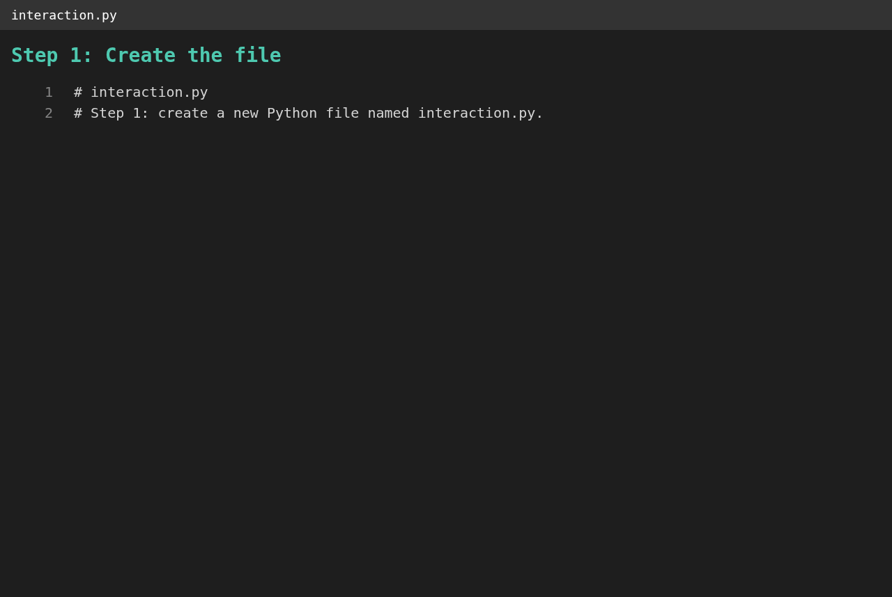
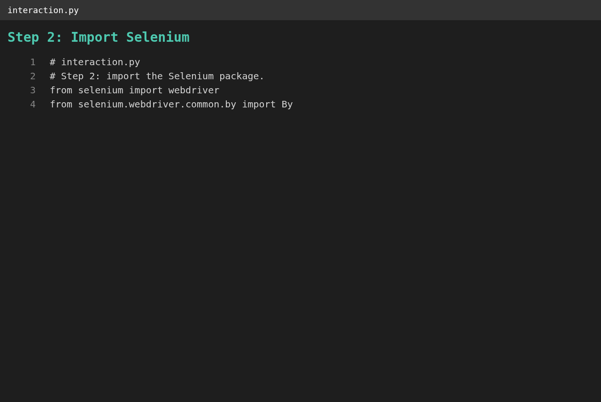
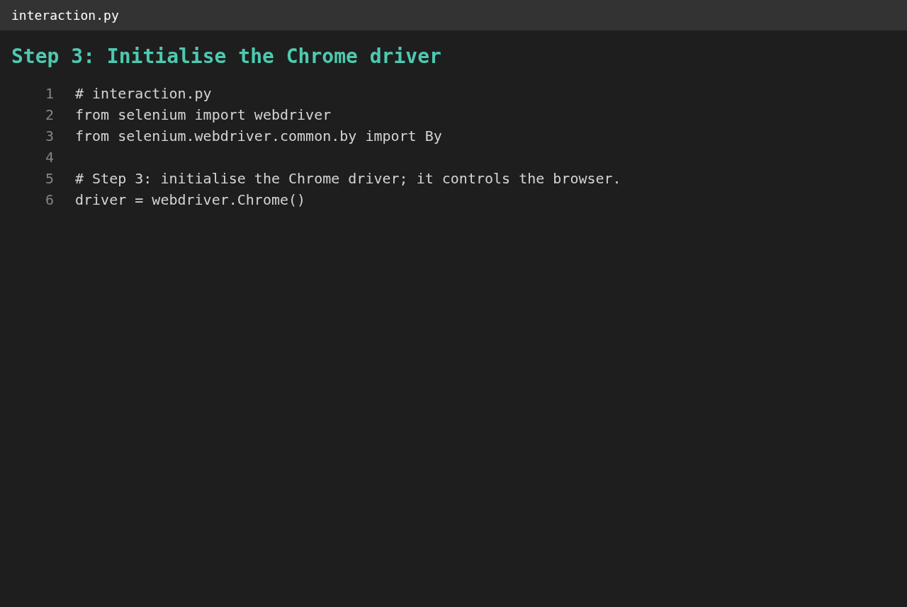
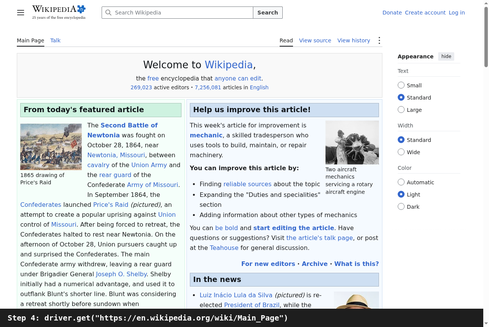
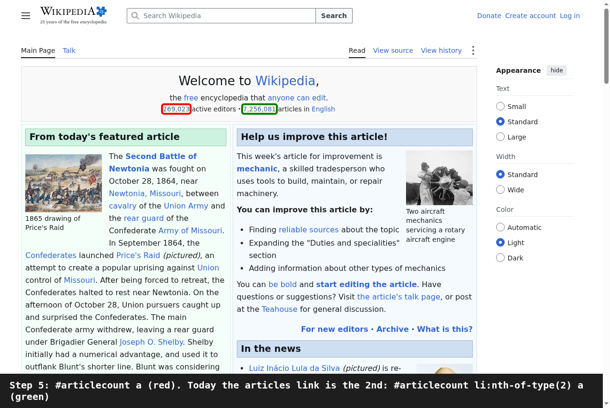
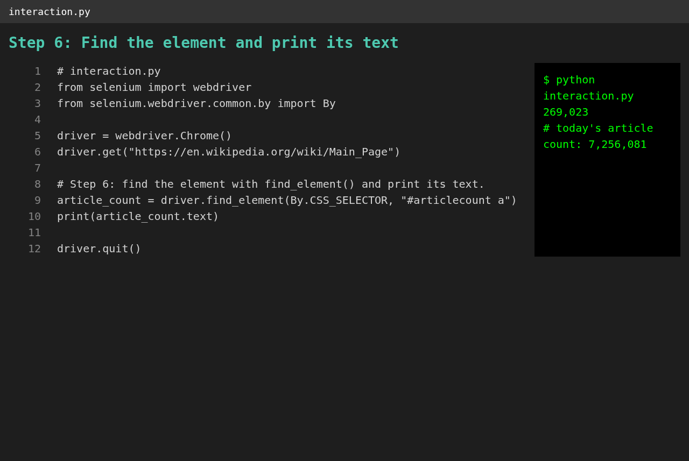
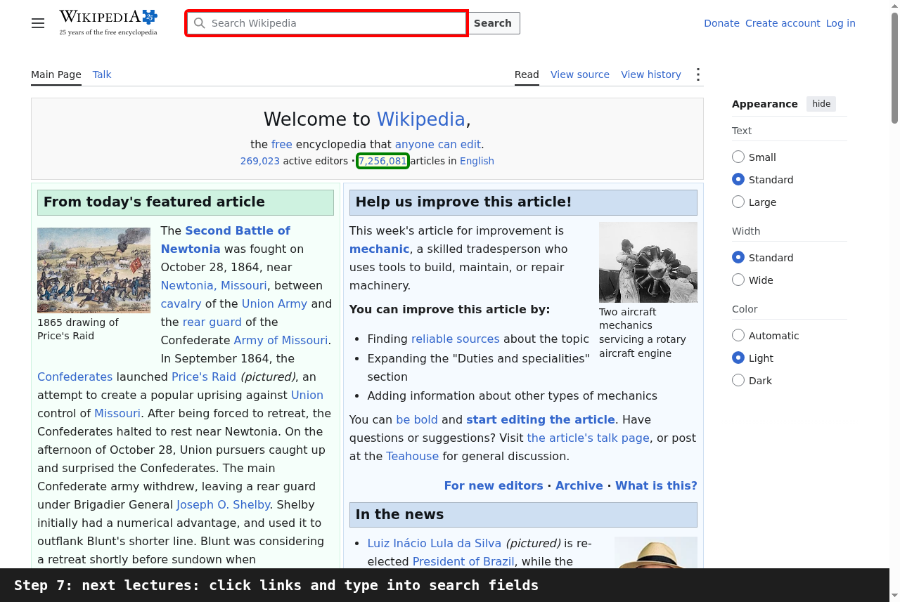

# 🚀 Scraping Wiki

A small Python project from Udemy's *100 Days of Code: The Complete Python Pro Bootcamp*: it drives Chrome with Selenium, opens the Wikipedia main page and prints the article count. It is for course participants who want to compare solutions and for visitors looking for ideas.

## 📚 Table of Contents

- [Overview](#-overview)
- [Requirements](#-requirements)
- [Setup](#-setup)
- [Run](#-run)
- [Tests](#-tests)
- [License](#-license)
- [Links](#-links)
- [Appendix: Project documents](#-appendix-project-documents)

## 🧭 Overview

The lecture builds `interaction.py` in seven steps: create the file, import Selenium, initialise the Chrome driver, navigate to Wikipedia with `get()`, identify the HTML element with a CSS selector, find it with `find_element` and print its text, and a hint at the next lectures (clicking links and typing into search fields). Each step has a screenshot below and an explanation in the [wiki][wiki] (English, Danish and Bahasa Malaysia).

| Part | What it is |
| --- | --- |
| `src/scraping_wiki/interaction.py` | The script: `create_driver`, `open_main_page`, `read_article_count`, `main` |
| `src/scraping_wiki/constants.py` | The page URL, the CSS selectors and the Chrome options |
| `tests/unit/` | pytest tests with a fake driver; they start no browser |
| `tests/e2e/` | End to end test and screenshot capture; run only in Docker |
| `docs/lecture-steps/` | The code of each lecture step, as built up in the lecture |
| `docs/screenshots/` | One screenshot per lecture step |
| `Dockerfile` | Headless Chromium for the end to end run |

### The lecture steps

**Step 1: create `interaction.py`.**


**Step 2: import Selenium.**


**Step 3: initialise the Chrome driver.**


**Step 4: navigate to the Wikipedia main page with `get()`.**


**Step 5: identify the HTML element.** The article count is a link inside the `div` with the id `articlecount`, so the lecture uses the CSS selector `#articlecount a`. Wikipedia has since added a second link in that `div`: the first match (red) is now the number of active editors, and the article count (green) is `#articlecount li:nth-of-type(2) a`, the selector the program uses (see [ADR-0002][ADR-0002]).


**Step 6: find the element with `find_element` and print its text.**


**Step 7: next lectures: click links and type into search fields.**


## 📋 Requirements

- Python 3.13 or newer
- Google Chrome (to run the script on your own machine; Selenium downloads the matching driver)
- `selenium`, the only runtime dependency (installed with the project)
- `pytest`, `ruff` and `mypy` for the tests and checks (installed with the `dev` extra)
- Optional: [Docker][docker] for the end to end run and the screenshots
- Optional: [Doxygen][doxygen] to build the API documentation

## 🛠️ Setup

Create a local virtual environment in the project folder:

```bash
python -m venv .venv
```

Activate it:

```bash
# Windows (PowerShell)
.venv\Scripts\Activate.ps1

# Windows (Git Bash)
source .venv/Scripts/activate

# Linux / macOS
source .venv/bin/activate
```

Upgrade pip and install the project with the test tools:

```bash
python -m pip install --upgrade pip
python -m pip install -e ".[dev]"
```

Leave the environment with `deactivate`. The `.env` file in a clone is for personal tooling only; the project never reads or imports it.

## ▶️ Run

With the environment active, this opens Chrome, loads the Wikipedia main page, prints the article count and closes the browser:

```bash
python -m scraping_wiki.interaction
```

The install also adds a console script, and `--headless` runs without a browser window:

```bash
scraping-wiki --headless
```

The output is one line, for example `7,256,081`.

## 🧪 Tests

The unit tests start no browser:

```bash
python -m pytest
```

Style and types:

```bash
python -m ruff check src tests
python -m mypy src tests
```

The end to end test and the screenshots need a browser, so they run in a Docker container and never on your desktop. The results (log, exit code and screenshots) land in `results/`:

```bash
docker build -t scraping-wiki-e2e .
docker run --rm -v "$(pwd)/results:/results" scraping-wiki-e2e
```

Build the API documentation from the Doxygen comments (written to `docs/doxygen/`):

```bash
doxygen Doxyfile
```

## 📄 License

[GNU Affero General Public License v3.0][license].

## 🔗 Links

- [Repository][repository]
- [Documentation][documentation]
- [Issue tracker][issues]

## 📎 Appendix: Project documents

The documents a newcomer needs, in reading order.

| Document | What it tells you |
| --- | --- |
| [AGENTS.md][agents] | The rules AI agents follow in this repository |
| [Business Case][BC-001] | Why the project exists, its scope and success criteria |
| [Stakeholder Analysis][SA-001] | Who is involved; the stakeholder IDs used for owners and reviewers |
| [Project Plan][PP-001] | The gateways and their schedule |
| [Milestones][milestones] | One document per gateway: Go/No-Go criteria and tasks |
| [Architecture decisions][adr] | Why the layout is flat and why the selector changed |
| [Review records][reviews] | The review of each document and of the code |
| [Artifact registry][registry] | Where each artifact type lives, the next version, the PO language and domain |
| [Framework README][framework-readme] | The framework this project uses |
| [Framework changelog][framework-changelog] | What changed in each framework release |

---

[repository]: https://git.tirsystem.com/Tirsvad-Udemy-100-days-of-code/048-scrapping-wiki
[documentation]: https://git.tirsystem.com/Tirsvad-Udemy-100-days-of-code/048-scrapping-wiki/wiki
[wiki]: https://git.tirsystem.com/Tirsvad-Udemy-100-days-of-code/048-scrapping-wiki/wiki
[issues]: https://git.tirsystem.com/Tirsvad-Udemy-100-days-of-code/048-scrapping-wiki/issues
[license]: ./LICENSE
[docker]: https://docs.docker.com/get-docker/
[doxygen]: https://www.doxygen.nl/
[ADR-0002]: ./docs/adr/adr-0002-article-count-selector.md
[agents]: ./AGENTS.md
[BC-001]: ./docs/business-case.md
[SA-001]: ./docs/stakeholder-analysis.md
[PP-001]: ./docs/project-plan.md
[milestones]: ./docs/milestones/
[adr]: ./docs/adr/
[reviews]: ./docs/sqa/reviews/
[registry]: ./docs/artifact-registry.md
[framework-readme]: ./framework/README.md
[framework-changelog]: ./framework/CHANGELOG.md
