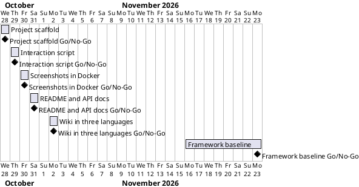

# Project Plan

## Metadata
| Key | Value |
| --- | --- |
| ID | PP-001 |
| CrossReference | [BC-001], [SA-001], [MIL-001], [MIL-002], [MIL-003], [MIL-004], [MIL-005], [MIL-006] |
| Language | en |
| Domain | education |

## Version History
| Date | Status | Author | Reviewer | Change | Commit |
| --- | --- | --- | --- | --- | --- |
| 2026-10-28 | Deprecated | Claude (AI) | S01 | Initial version; accepted by the Product Owner's acceptance of the plan | [b344b6e] |
| 2026-11-16 | Deprecated | Jens Tirsvad Nielsen | AI as stand-in for S01 | Added the baseline gateway MIL-006 with its schedule row, scope coverage, dependency, risk and Gantt entries; recorded the move of the end date, the domain, the live-site rule and the shared wiki workflow in the Planning Assumptions and Open Issues; set the domain to education; reviewed in autonomous mode, not independent | [915cba5] |
| 2026-11-16 | Accepted | Jens Tirsvad Nielsen | AI as stand-in for S01 | Added the indentation of `tests/e2e/run_e2e.sh` to the main deliverable of MIL-006; reviewed in autonomous mode, not independent | pending |

---

## Purpose

Schedule the five phases that deliver the Selenium Wikipedia lecture of Udemy's "100 Days of Code" as a tested, documented Python project with a screenshot for each lecture step and a wiki in English, Danish and Bahasa Malaysia. Each phase is one branch and one pull request, so the steps can be followed in the git history; each task is synced as an issue. A sixth gateway, the framework baseline ([MIL-006]), follows them.

## Planning Assumptions

- Work starts 2026-10-28 and ends by 2026-11-02, about one phase per day. Source: the Product Owner's prompt; [BC-001] has no fixed deadline, so no constraint is exceeded.
- Owner is the Product Owner S01 (source: [SA-001]). In autonomous mode the AI reviews each artifact as stand-in for S01 and the review record says so.
- The baseline gateway MIL-006 starts 2026-11-16 and ends 2026-11-23, one week (source: [BC-001], Constraints). It brings the finished project to the baseline of the framework, a decision of S01; the first five gateways keep their dates, so the end date of the plan moves from 2026-11-02 to 2026-11-23 because of it.
- For MIL-006 S01 has authorised the assistant to commit, push, open the pull request and merge it, and the review is done by an AI stand-in for S01 (source: [BC-001], Constraints and Risks).
- Product Owner language English, domain IT; wiki languages English, Danish and Bahasa Malaysia (source: the Product Owner's prompt, recorded in the registry).
- Source for the rest: the Product Owner's prompt and the Constraints of [BC-001]. Python 3.13 or newer, `venv`, `pytest`, `src/ tests/ docs/` layout, constants in `constants.py`, Doxygen comments.
- Browser and screenshot runs happen in Docker only, never on the host desktop ([gui-testing.md](../framework/process/gui-testing.md)).
- `.env` holds personal tokens used only by tooling; the project never reads, imports or tests it, and `.dockerignore` keeps it out of the image.
- One branch and one pull request per phase; the merge is done through the host's API once the checks are green.

## Gateway Schedule

| Gateway | Document | Window | Decision date | Owner | Stories | Main deliverable | Milestone |
| --- | --- | --- | --- | --- | --- | --- | --- |
| Project scaffold | [MIL-001] | 2026-10-28 | 2026-10-28 | S01 | none (technical tasks) | `pyproject.toml`, `.gitignore`, `src/` and `tests/` skeletons, `Doxyfile`, repository description and topics, `origin` corrected | [Milestone 277] |
| Interaction script | [MIL-002] | 2026-10-29 | 2026-10-29 | S01 | none (technical tasks) | `src/scraping_wiki/constants.py`, `interaction.py` with Doxygen comments, and unit tests | [Milestone 278] |
| Screenshots in Docker | [MIL-003] | 2026-10-30 | 2026-10-30 | S01 | none (technical tasks) | `Dockerfile`, `.dockerignore`, end to end (e2e) run, lecture step scripts and 7 screenshots in `docs/screenshots/` | [Milestone 279] |
| README and API docs | [MIL-004] | 2026-10-31 | 2026-10-31 | S01 | none (technical tasks) | `README.md` from the template with the 7 screenshots, verified Doxygen build | [Milestone 280] |
| Wiki in three languages | [MIL-005] | 2026-11-02 | 2026-11-02 | S01 | none (technical tasks) | `docs/wiki/` in en, da and ms with screenshots and sidebar, publish workflow | [Milestone 281] |
| Framework baseline | [MIL-006] | 2026-11-16 to 2026-11-23 | 2026-11-23 | S01 | none (technical tasks) | Branch `mil-006-framework-baseline` merged: the adopted framework release, the wiki in the framework's shape, the README, licence and project URL metadata, the traceability matrix, review records and the indentation of the end to end shell script | [Milestone 565] |



## Scope Coverage

| Scope item | Gateway |
| --- | --- |
| `pyproject.toml`, `.gitignore`, folder layout, `Doxyfile`, repository description and topics | [MIL-001] |
| `interaction.py`, constants, Doxygen comments, pytest tests without a browser | [MIL-002] |
| Dockerfile, end to end run, screenshot for each lecture step | [MIL-003] |
| README with `.venv`, pip upgrade, run and test instructions; Doxygen build | [MIL-004] |
| Wiki in English, Danish and Bahasa Malaysia explaining what each lecture step taught | [MIL-005] |
| The baseline: framework release, wiki shape, README, licence and project URL metadata, traceability matrix, review records | [MIL-006] |

## Dependencies

```
MIL-001 -> MIL-002 -> MIL-003 -> MIL-004 -> MIL-005 -> MIL-006
```

A No-Go moves every later gateway, and the end date, by the time needed to fix the failed criterion. S01, as Product Owner, decides the move of the end date; for MIL-006 it moved from 2026-11-02 to 2026-11-23.

## Plan Risks

| Risk | Impact | Mitigation |
| --- | --- | --- |
| Wikipedia changes the main page (BC risk 1) | Selector and screenshots go stale | Selector in `constants.py`; e2e run is the check |
| Docker image build fails or is slow (BC risk 2) | MIL-003 slips | Pin the base image; use distribution packages for Chromium |
| Wiki publish workflow needs a runner and an organization secret | Wiki not published by merge | The pages exist in `docs/wiki/` either way; publishing is reported, not blocked |
| Three-language wiki takes longer than a day (BC risk 5) | MIL-005 slips | English first; da and ms follow page by page |
| Token in `.env` leaks through a commit or the Docker image (BC risk 3) | Account compromise | `.gitignore` and `.dockerignore` exclude `.env`; checked in MIL-001 and MIL-003 |
| A continuous integration (CI) check fails on the pull request of MIL-006 | The merge is delayed past 2026-11-23 | The failure is fixed on the same branch and the checks run again; after three failed rounds on one cause the work stops and S01 decides (trace: success criterion 8 of [BC-001]) |

## Open Issues

- The prompt names `https://git.tirsystem.com/Tirsvad-Udemy-100_days_of_code`. Checked through the host's API on 2026-10-28: that owner name and the current `origin` owner (`Tirsvad-Udemy-100-days-of-code`) resolve to the same repository `048-scrapping-wiki`, so `origin` is correct and stays.
- "Python greater than 3.13" is read as 3.13 or newer (`requires-python = ">=3.13"`), as in 010-calc.
- S03 wants no runtime dependencies; the lecture needs Selenium, so it is the single runtime dependency (conflict recorded in [SA-001]).
- Whether the repository is public decides whether `docs/ai-prompts/` is ignored ([ai-prompt-log.md](../framework/process/ai-prompt-log.md)); checked on 2026-10-28 through the host's API: the repository is public, so `/docs/ai-prompts/` is ignored (MIL-001).
- The Gateway Schedule links the milestones of the git host that existed; the baseline milestone is linked after the sync.
- Domain: since [MIL-006] the plan, the Business Case and the baseline milestone have the domain `education`. The other documents (Stakeholder Analysis, milestones MIL-001 to MIL-005 and the review records RC-001 to RC-012) keep the domain `it` they were accepted with; they are not changed by the baseline, and a change of their domain would need a new review of each.
- Live services: running the program opens the real Wikipedia main page in Chrome and prints the article count; it submits nothing and uses no account or personal data. MIL-006 opens no web page, starts no browser and runs no container; the unit tests use a fake driver. The reader checks the terms of use of a site before running the program against it.
- The wiki publish workflow of [MIL-005] (criterion 5, `.gitea/workflows/publish-wiki.yml`) was removed from the repository on 2026-11-09 in favour of the shared workflows of the git host (commit `d0dface`); the repository has no workflow file of its own. The accepted [MIL-005] is not changed.
- The traceability matrix TM-001 did not exist before the baseline; it is created with the baseline.

---

[BC-001]: ./business-case.md
[SA-001]: ./stakeholder-analysis.md
[MIL-001]: ./milestones/mil-001-project-scaffold.md
[MIL-002]: ./milestones/mil-002-interaction-script.md
[MIL-003]: ./milestones/mil-003-screenshots-in-docker.md
[MIL-004]: ./milestones/mil-004-readme-and-api-docs.md
[MIL-005]: ./milestones/mil-005-wiki.md
[Milestone 277]: https://git.tirsystem.com/Tirsvad-Udemy-100-days-of-code/048-scrapping-wiki/milestone/277
[Milestone 278]: https://git.tirsystem.com/Tirsvad-Udemy-100-days-of-code/048-scrapping-wiki/milestone/278
[Milestone 279]: https://git.tirsystem.com/Tirsvad-Udemy-100-days-of-code/048-scrapping-wiki/milestone/279
[Milestone 280]: https://git.tirsystem.com/Tirsvad-Udemy-100-days-of-code/048-scrapping-wiki/milestone/280
[Milestone 281]: https://git.tirsystem.com/Tirsvad-Udemy-100-days-of-code/048-scrapping-wiki/milestone/281
[b344b6e]: https://git.tirsystem.com/Tirsvad-Udemy-100-days-of-code/048-scrapping-wiki/commit/b344b6e2cba397e23714c73a45ad4155bb1e00e0
[MIL-006]: ./milestones/mil-006-framework-baseline.md
[Milestone 565]: https://git.tirsystem.com/Tirsvad-Udemy-100-days-of-code/048-scrapping-wiki/milestone/565
[915cba5]: https://git.tirsystem.com/Tirsvad-Udemy-100-days-of-code/048-scrapping-wiki/commit/915cba58cb9ea86be0193540eb965d78f4862548
