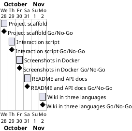

# Project Plan

## Metadata
| Key | Value |
| --- | --- |
| ID | PP-001 |
| CrossReference | [BC-001], [SA-001], [MIL-001], [MIL-002], [MIL-003], [MIL-004], [MIL-005] |
| Language | en |
| Domain | it |

## Version History
| Date | Status | Author | Reviewer | Change | Commit |
| --- | --- | --- | --- | --- | --- |
| 2026-10-28 | Accepted | Claude (AI) | S01 | Initial version; accepted by the Product Owner's acceptance of the plan | [b344b6e] |

---

## Purpose

Schedule the five phases that deliver the Selenium Wikipedia lecture of Udemy's "100 Days of Code" as a tested, documented Python project with a screenshot for each lecture step and a wiki in English, Danish and Bahasa Malaysia. Each phase is one branch and one pull request, so the steps can be followed in the git history; each task is synced as an issue.

## Planning Assumptions

- Work starts 2026-10-28 and ends by 2026-11-02, about one phase per day. Source: the Product Owner's prompt; [BC-001] has no fixed deadline, so no constraint is exceeded.
- Owner is the Product Owner S01 (source: [SA-001]). In autonomous mode the AI reviews each artifact as stand-in for S01 and the review record says so.
- Product Owner language English, domain IT; wiki languages English, Danish and Bahasa Malaysia (source: the Product Owner's prompt, recorded in the registry).
- Source for the rest: the Product Owner's prompt and the Constraints of [BC-001]. Python 3.13 or newer, `venv`, `pytest`, `src/ tests/ docs/` layout, constants in `constants.py`, Doxygen comments.
- Browser and screenshot runs happen in Docker only, never on the host desktop ([gui-testing.md](../framework/process/gui-testing.md)).
- `.env` holds personal tokens used only by tooling; the project never reads, imports or tests it, and `.dockerignore` keeps it out of the image.
- One branch and one pull request per phase; the merge is done through the host's API once the checks are green.

## Gateway Schedule

| Gateway | Document | Window | Decision date | Owner | Stories | Main deliverable | Milestone |
| --- | --- | --- | --- | --- | --- | --- | --- |
| Project scaffold | [MIL-001] | 2026-10-28 | 2026-10-28 | S01 | none (technical tasks) | `pyproject.toml`, `.gitignore`, `src/` and `tests/` skeletons, `Doxyfile`, repository description and topics, `origin` corrected | not yet synced |
| Interaction script | [MIL-002] | 2026-10-29 | 2026-10-29 | S01 | none (technical tasks) | `src/scraping_wiki/constants.py`, `interaction.py` with Doxygen comments, and unit tests | not yet synced |
| Screenshots in Docker | [MIL-003] | 2026-10-30 | 2026-10-30 | S01 | none (technical tasks) | `Dockerfile`, `.dockerignore`, end to end (e2e) run, lecture step scripts and 7 screenshots in `docs/screenshots/` | not yet synced |
| README and API docs | [MIL-004] | 2026-10-31 | 2026-10-31 | S01 | none (technical tasks) | `README.md` from the template with the 7 screenshots, verified Doxygen build | not yet synced |
| Wiki in three languages | [MIL-005] | 2026-11-02 | 2026-11-02 | S01 | none (technical tasks) | `docs/wiki/` in en, da and ms with screenshots and sidebar, publish workflow | not yet synced |



## Scope Coverage

| Scope item | Gateway |
| --- | --- |
| `pyproject.toml`, `.gitignore`, folder layout, `Doxyfile`, repository description and topics | [MIL-001] |
| `interaction.py`, constants, Doxygen comments, pytest tests without a browser | [MIL-002] |
| Dockerfile, end to end run, screenshot for each lecture step | [MIL-003] |
| README with `.venv`, pip upgrade, run and test instructions; Doxygen build | [MIL-004] |
| Wiki in English, Danish and Bahasa Malaysia explaining what each lecture step taught | [MIL-005] |

## Dependencies

```
MIL-001 -> MIL-002 -> MIL-003 -> MIL-004 -> MIL-005
```

A No-Go moves every later gateway, and the end date, by the time needed to fix the failed criterion. S01, as Product Owner, decides the move of the end date.

## Plan Risks

| Risk | Impact | Mitigation |
| --- | --- | --- |
| Wikipedia changes the main page (BC risk 1) | Selector and screenshots go stale | Selector in `constants.py`; e2e run is the check |
| Docker image build fails or is slow (BC risk 2) | MIL-003 slips | Pin the base image; use distribution packages for Chromium |
| Wiki publish workflow needs a runner and an organization secret | Wiki not published by merge | The pages exist in `docs/wiki/` either way; publishing is reported, not blocked |
| Three-language wiki takes longer than a day (BC risk 5) | MIL-005 slips | English first; da and ms follow page by page |
| Token in `.env` leaks through a commit or the Docker image (BC risk 3) | Account compromise | `.gitignore` and `.dockerignore` exclude `.env`; checked in MIL-001 and MIL-003 |

## Open Issues

- The prompt names `https://git.tirsystem.com/Tirsvad-Udemy-100_days_of_code`. Checked through the host's API on 2026-10-28: that owner name and the current `origin` owner (`Tirsvad-Udemy-100-days-of-code`) resolve to the same repository `048-scrapping-wiki`, so `origin` is correct and stays.
- "Python greater than 3.13" is read as 3.13 or newer (`requires-python = ">=3.13"`), as in 010-calc.
- S03 wants no runtime dependencies; the lecture needs Selenium, so it is the single runtime dependency (conflict recorded in [SA-001]).
- Whether the repository is public decides whether `docs/ai-prompts/` is ignored ([ai-prompt-log.md](../framework/process/ai-prompt-log.md)); checked on 2026-10-28 through the host's API: the repository is public, so `/docs/ai-prompts/` is ignored (MIL-001).
- Milestone links in the Gateway Schedule are filled in after the publish (until then each row says `not yet synced`).

---

[BC-001]: ./business-case.md
[SA-001]: ./stakeholder-analysis.md
[MIL-001]: ./milestones/mil-001-project-scaffold.md
[MIL-002]: ./milestones/mil-002-interaction-script.md
[MIL-003]: ./milestones/mil-003-screenshots-in-docker.md
[MIL-004]: ./milestones/mil-004-readme-and-api-docs.md
[MIL-005]: ./milestones/mil-005-wiki.md
[b344b6e]: https://git.tirsystem.com/Tirsvad-Udemy-100-days-of-code/048-scrapping-wiki/commit/b344b6e2cba397e23714c73a45ad4155bb1e00e0
